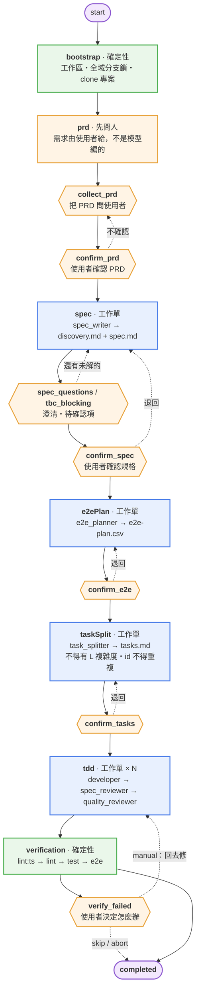
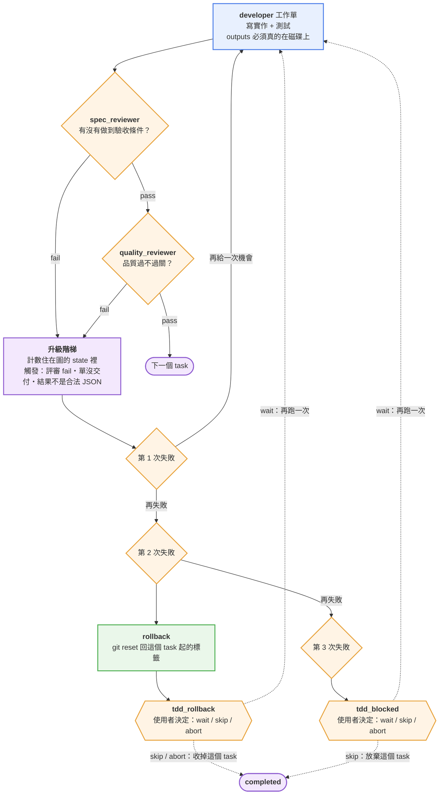

# sdd-graph

**圖（LangGraph）擁有階段路由，Claude Code 會話負責把工作單做完。**

一個 Claude Code 插件：一條 SDD（Spec-Driven Development）流程，七個階段，
每一段都有一張「工作單」。工作單不是拿來讀的，是拿來**做**的 ——
模型不再自己決定下一個階段是什麼，**圖決定**；模型只負責把手上那張單做完，然後回報。

- [這是什麼](#這是什麼)
- [快速開始：在一個新專案裡用起來](#快速開始在一個新專案裡用起來)
- [目標專案要準備什麼](#目標專案要準備什麼)
- [七個階段](#七個階段)
- [`/sdd-graph:*` 指令](#sdd-graph-指令)
- [CLI 合約](#cli-合約)
- [Interrupt 類型](#interrupt-類型)
- [檔案落在哪裡](#檔案落在哪裡)
- [換會話、暫停、恢復](#換會話暫停恢復)
- [為什麼是這樣設計](#為什麼是這樣設計)
- [開發](#開發)
- [v1 不做的清單](#v1-不做的清單)
- [參考文件](#參考文件)

---

## 這是什麼

一般的「AI 寫程式」流程裡，模型自己決定接下來做什麼：先問需求？還是先看程式碼？
寫完要不要測試？測試失敗要改哪裡？每一步都靠模型判斷，**同一個需求跑兩次會走不同的路**，
而且中途被切斷之後沒有人知道跑到哪了。

`sdd-graph` 把「決定流程」跟「做事情」拆開：

```
使用者 ──對話──► Claude Code 會話（/sdd-graph:* 指令）
                    │
                    │  循環：跑圖 → 看 payload → 問人 or 幹活 → complete / approve
                    ▼
              sdd-graph CLI（bin/sdd-graph）
                    │
                    ▼
             LangGraph + SqliteSaver
               確定性節點就地執行（bootstrap / verify / git / parse）
               需要人腦的節點 = interrupt（audience: user）
               需要動手的工作單 = interrupt（audience: host）
```

- **圖**（LangGraph）決定下一個階段是什麼、什麼時候要問人、什麼時候要發工作單。
  這條路由是**確定的**：同樣的狀態一定走同樣的路。
- **會話**（Claude Code）拿到一張工作單，用自己既有的工具（寫檔、跑測試、拉 Figma）
  把它做完，然後回報「做完了，产出在這裡」。
- 中斷之後**可以接著做**：進度存在 checkpoint（sqlite）裡，不是存在對話裡。

**兩種 audience 嚴格分開**：

| audience | 誰來處理 | 用哪個指令 | payload |
|---|---|---|---|
| `user` | 人（Claude Code 會話把問題問出來） | `sdd-graph approve` | 問題／選項 |
| `host` | 本會話的工具（寫檔、跑測試、拉 Figma） | `sdd-graph complete` | 工作單（role／prompt／inputs／outputs） |

`approve` 去答一張 `host` 的單、或 `complete` 去答一張 `user` 的閘口，都會被擋下來
（`audience_mismatch`）—— 兩條路徑不會互相走錯。

---

## 快速開始：在一個新專案裡用起來

外掛是**裝在機器上**的（user scope），不是裝在某個專案裡。裝好之後，
任何專案的 Claude Code 會話裡都會有 `/sdd-graph:*` 這幾個指令。

### 步驟 0 — 前提

| 需要 | 版本／說明 |
|---|---|
| Node.js | **≥ 20.11**（測試用到 `import.meta.dirname`） |
| git | 能 clone、能建分支 |
| Claude Code | 支援插件的版本（本外掛在 2.1.295 上驗過） |
| Figma MCP | **選配** —— 只有在你要給 Figma 網址時才需要 |

### 步驟 1 — 取得並安裝外掛

```bash
git clone https://github.com/sukunwei/frontend-sdd-agent.git
cd frontend-sdd-agent
npm install
```

`npm install` 會裝上執行時需要的 `@langchain/langgraph`、
`@langchain/langgraph-checkpoint-sqlite`、`zod`，還有 `tsx`（`bin/sdd-graph` 是一支
tsx shim）。

### 步驟 2 — 裝成 Claude Code 插件

**這個倉庫自己就是一個 marketplace**：`.claude-plugin/marketplace.json` 宣告了唯一的
plugin `sdd-graph`，來源就是倉庫根目錄（`"./"`）。

```bash
claude plugin marketplace add /絕對路徑/frontend-sdd-agent
claude plugin install sdd-graph@sdd-graph
```

> **為什麼不用 symlink。** 常見的作法是「在一個 local marketplace 裡放一個指向本目錄的
> symlink」。**現在的 Claude Code 會拒絕這種來源**：
>
> ```
> Plugin source path refused: ./plugins/sdd-graph does not stay inside its
> marketplace directory. Check that the marketplace entry has a plain relative path.
> ```
>
> 外掛的來源必須是 marketplace 目錄裡的一個**普通相對路徑**。把倉庫自己當成
> marketplace（來源是 `"./"`）就沒有這個問題，而且少一份要同步的副本。

> **改了外掛之後不用重裝。** 目錄來源的 marketplace 是**直接從那個資料夾讀**的
> （`claude plugin list` 會寫 `Read from: <目錄>`）。改了外掛之後**重開會話**
> （或 `/reload-plugins`）就會生效。

### 步驟 3 — 確認裝好了

```bash
claude plugin list | grep -A 4 sdd-graph
```

應該看到：

```
  ❯ sdd-graph@sdd-graph
    Version: 0.2.0
    Read from: /絕對路徑/frontend-sdd-agent
    Scope: user
    Status: ✔ enabled
```

再確認 CLI 跑得起來：

```bash
/絕對路徑/frontend-sdd-agent/bin/sdd-graph status --task demo
```

它會回 `no_checkpoint` 並退出 1 —— 那是對的（沒有那一輪的進度），它證明 CLI 跑得起來。

### 步驟 4 — 在你的專案裡開始第一輪

開一個新的 Claude Code 會話，**cd 到你的專案**，然後：

```
/sdd-graph:start --task my-feature --repo https://github.com/you/your-app.git
```

`--task` 是這一輪的名字（會被正規化成 kebab-case，同時是 thread id、branch 名稱
`task/<name>` 與需求文件目錄 `docs/<name>/` 的來源）。`--repo` 是要做的那個 repo。

接下來會發生什麼：

1. 圖在**外掛的工作區**裡 clone 那個 repo（`<外掛目錄>/workspace/tasks/my-feature/repo`），
   開一條 `task/my-feature` 分支，並且**拿住全域的分支鎖**。
2. 圖停在 `collect_prd`，把 PRD 的問題**問你**（需求是使用者給的，不是模型編的）。
3. 你回答 → 圖進 `spec` → 發一張 `spec_writer` 工作單給會話 → 會話寫出
   `discovery.md` + `spec.md`（含驗收條件 `AC-001`…）→ 圖解析、追問、確認。
4. `e2ePlan` → `taskSplit` → `tdd`（每個 task 一輪：實作 → 規格審查 → 品質審查）
   → `verification`（四道關卡）→ `completed`。
5. 每一段要你確認的閘口（`confirm_prd` / `confirm_spec` / `confirm_e2e` / `confirm_tasks`）
   都會問你。

### 步驟 5 — 一輪下來會留下什麼

- **在你原本的 repo 裡**：`task/my-feature` 分支上有 `docs/my-feature/` 底下的
  `prd.md`、`discovery.md`、`spec.md`、`e2e-plan.csv`、`tasks.md`、
  `workflow-state.json`、`verify/*.log`，以及實作出来的程式碼與測試。
  這些會被 commit 在那條分支上（`git push` 失敗不影響流程，只是分支留在本地）。
- **在外掛目錄裡**：`workspace/tasks/my-feature/`（clone 與 metadata）、
  `runtime/checkpoints.sqlite`（這一輪的進度）、`runtime/branch-runtime-lock.json`
  （全域的分支鎖）。

---

## 目標專案要準備什麼

`sdd-graph` 會**真的** clone 你的專案、真的跑你的工具鏈。所以目標 repo 要符合：

| 需要 | 說明 |
|---|---|
| **是個 git repo** | 能被 clone（https／ssh／`file://`／本機路徑都可以）。不需要先有 `main` 分支以外的東西。 |
| **四道關卡的工具** | 驗證階段會在 clone 出來的 repo 裡跑這四個指令（**版本寫死在 `src/nodes/verify-checks.ts`**）：<br>`npx tsc --noEmit` ／ `npx eslint . --ext .ts,.tsx --fix` ／ `npx jest --passWithNoTests --no-coverage` ／ `npx playwright test` |
| **eslint 8** | `--ext` 這個選項在 eslint 9 已被移除。專案裡要有 `eslint`（v8）與一份設定檔。 |
| **可以 commit** | 會話會把工作 commit 在 `task/<name>` 分支上。 |
| **（選配）Figma MCP** | 你在 PRD 階段給了 Figma 網址時，會話會用 Figma MCP 抓設計資源。 |

> **想改關卡的指令？** v1 把它寫死了 —— 這是刻意的：那四道關卡就是這個外掛的
> 「品質底線」，不該由每個專案各自定義。要改的話改 `VERIFY_CHECKS` 那一段，
> 順便把 `tests/verify-*.test.ts` 一起改。

---

## 七個階段

```
bootstrap → prd → spec → e2ePlan → taskSplit → tdd → verification → completed
```

| 階段 | 誰執行 | 產出 | 閘口 |
|---|---|---|---|
| `bootstrap` | 確定性（圖內） | workspace、分支鎖、clone、run-metadata | 鎖衝突／舊 run 要 resume 還是 reset |
| `prd` | **先問人** | `prd.md` | `collect_prd` →（有 Figma URL 才）`figma_fetch` → `confirm_prd` |
| `spec` | 工作單 | `discovery.md` + `spec.md` | `figma_missing`、澄清最多 3 輪、blocking TBC 未解不得離開、`confirm_spec` |
| `e2ePlan` | 工作單 | `e2e-plan.csv` | `confirm_e2e` |
| `taskSplit` | 工作單 | `tasks.md` | 不得有 `L`、id 不得重複、id 要由標題派生、`confirm_tasks` |
| `tdd` | 工作單 × N（開發者 → 規格審查 → 品質審查） | 程式碼、測試、評審 JSON | 失敗兩次 rollback、第三次問使用者 |
| `verification` | 確定性（圖內） | 四道關卡的結果 | `lint:ts` → `lint` → `test` → `e2e`，失敗要使用者決定 |

### 流程圖

> 下面的圖是 [mermaid](https://mermaid.js.org/) —— GitHub 會直接渲染。用純文字看
> README 的話，表格與程式碼區塊說的是同一件事。



| 顏色 | 意思 |
|---|---|
| 橘 | 使用者閘口 —— 要人決定 |
| 藍 | 工作單 —— 會話用本會話的工具做 |
| 綠 | 圖內確定性 —— 圖自己算完 |
| 紫 | 起訖 |

`prd` 階段是**先問人**的：需求是使用者給的，不是模型編的。
每一段的需求文件都寫在 repo 裡（`docs/<requirement>/`），跟程式碼一起被 commit。

**TDD 迴圈**是三張單一輪：會話拿到 `developer` 工作單（要寫實作**和**測試）→
`spec_reviewer`（有沒有做到驗收條件）→ `quality_reviewer`（品質過不過關）。
評審不通過就回到 developer。連續失敗會 `rollback`（回到這個 task 起的 git 標籤），
第三次才會問使用者。

### TDD 的一輪



---

## `/sdd-graph:*` 指令

| 指令 | 作用 |
|---|---|
| `/sdd-graph:start --task <name> --repo <url>` | 開始一輪：跑圖、依退出碼分支，一路問人或幹活到結束 |
| `/sdd-graph:resume --task <name>` | 從 checkpoint **重發同一張**未完成的工作單（換會話也能接著做） |
| `/sdd-graph:status --task <name>` | **只讀**：目前階段、待處理的中斷、分支鎖。不推進任何階段 |
| `/sdd-graph:stop --task <name>` | 釋放分支鎖；**保留** checkpoint 與工作區 |
| `/sdd-graph:change --task <name>` | v1 只預留：回 `not_implemented`，不會默默忽略 |

指令本體只有一個控制流（`commands/start.md` 與 `commands/resume.md` 裡同一份 LOOP）：

```
LOOP:
  1. 執行 sdd-graph start --task <taskName> --repo <repoUrl>
  2. 依退出碼分支：
     - exit 0：階段已完成，向使用者回報，結束
     - exit 2：讀 stdout 的 JSON 信封，依 audience 分支
         · audience=user：把 payload 的 question/options 問使用者；
           使用者答完後執行 sdd-graph approve --task <taskName> --payload '<json>'
         · audience=host：依 payload.role 與 payload.prompt，用本會話工具完成 payload.outputs；
           完成後執行 sdd-graph complete --task <taskName> --result '<json>'
     - exit 1：讀 stderr，向使用者回報錯誤，結束
  3. 回到步驟 1
```

---

## CLI 合約

```bash
sdd-graph start    --task <n> --repo <url>
sdd-graph resume   --task <n>
sdd-graph complete --task <n> --result <json|@file>
sdd-graph approve  --task <n> --payload <json|@file>
sdd-graph status   --task <n>
sdd-graph stop     --task <n> [--force]
sdd-graph change   --task <n>
```

**退出碼就是合約**，stdout 的 JSON 只說「發生了什麼」：

| exit | 意思 | stdout | stderr |
|---|---|---|---|
| `0` | 圖走到 `completed`（或這次命令沒有待處理的東西） | `{"kind":"result",...}` | - |
| `2` | 有待處理的中斷 | `{"kind":"interrupt","audience":...,"type":...,"threadId":...,"stage":...,"payload":...}` | - |
| `1` | 參數錯、沒有這個 thread、違反 audience 合約 | - | `{"kind":"error","code":...,"message":...}` |

宿主（Claude Code 會話）拿到退出碼之後做的事：


stderr 上會出現的錯誤碼：`invalid_arguments`、`no_checkpoint`、`audience_mismatch`、
`invalid_result`、`invalid_payload`、`invalid_order`、`already_completed`、
`lock_not_owned`、`not_implemented`、`internal_error`。

**工作單的輸出必須真的在磁碟上**：`complete` 會檢查工作單 `outputs` 裡的每個路徑。
沒寫出來 → **同一張單再發一次**，而且不計任何失敗次數（那不是品質問題，
是工人根本沒做完）。

**閘口答案的形狀很寬**：`approve` 可以收純字串，或任何帶著 `action`／`answer`／
`comment`／`text`／`option`／`value`／`response`／`decision`／`choice` 其中一個欄位的
物件。看不懂的形狀**不會**被當成「還沒回答」—— 圖會帶著 `previousAnswer` 再問一次，
而不是把你的答案吞掉。

---

## Interrupt 類型

圖會停下來的每一種理由都在這張表裡。表以外的 type 沒有被圖發出過。

| type | audience | 什麼時候 | 回來時帶什麼 |
|---|---|---|---|
| `already_exists` | user | `start` 撞到舊 run | `{ action: 'resume' \| 'reset' }` |
| `lock_conflict` | user | bootstrap | `{ action: 'wait' \| 'stop_other' }` |
| `bootstrap_failed` | user | 複製連續失敗 | `{ code, message }` |
| `collect_prd` | user | prd 入口 | `{ prdMarkdown, figmaUrl? }` |
| `figma_missing` | user | spec 入口，設計資源不在 | `{ action: 'fetch' \| 'tbc' \| 'skip' }` |
| `figma_needs_human` | user | Figma 那一班的工人卡住了，要使用者決定 | `{ question, options }` |
| `work_order`（role=`figma_fetch`） | host | 使用者給了 Figma URL | `WorkerResult` |
| `work_order`（role=spec_writer 等） | host | 寫作／實作／評審 | `WorkerResult` |
| `worker_needs_human` | user | 工人卡住，要使用者決定（spec／e2e／task split） | `{ question, options }` |
| `confirm_prd` / `confirm_spec` / `confirm_e2e` / `confirm_tasks` | user | 階段出口 | `{ approved, comment? }` |
| `spec_questions` | user | spec 的澄清 | `{ answers }` |
| `tbc_blocking` | user | 推進前 | `{ resolutions }` |
| `spec_failed` | user | 規格讀不到，或沒有驗收條件 | `{ reason, message?, options: ['retry', 'abort'] }` |
| `e2e_plan_failed` | user | E2E 計畫沒有 test id | `{ reason, message? }` |
| `task_split_failed` | user | `tasks.md` 不合法（複雜度、id、AC 引用） | `{ reason, message? }` |
| `tdd_rollback` / `tdd_blocked` | user | TDD 升級 | `{ action: 'wait' \| 'skip' \| 'abort' }` |
| `verify_failed` | user | 四道關卡有 failed | `{ action: 'manual' \| 'skip' \| 'abort' }` |

**閘門的 payload 還會多帶這些欄位**（有的話）：

| 欄位 | 什麼時候 | 意思 |
|---|---|---|
| `rollback` | `tdd_rollback` | 程式碼到底有沒有被還原：`done`（還原了）、`skipped`（沒有 repository，沒得還原）、`failed`（有 repository 但 reset 失敗）。**後兩種情況壞掉的程式碼還在磁碟上。** |
| `previousAnswer` | 使用者的答案圖看不懂時 | 上一次那個看不懂的答案（原文）。圖會把閘門再問一次，帶著這個診斷。 |
| `note` | 同上 | 為什麼要再問一次。 |

工作單的 role：`figma_fetch`、`spec_writer`、`e2e_planner`、`task_splitter`、
`developer`、`spec_reviewer`、`quality_reviewer`。
工作單的正文在 `prompts/<role>.md`（模板），由 `src/prompts/loader.ts` 填入
目標、工作目錄、必讀輸入、必交輸出與產出格式。

---

## 檔案落在哪裡

```
<外掛目錄>/
├── workspace/tasks/<task>/
│   ├── repo/                     ← clone 出來的專案（會被 commit 的都在這裡）
│   │   ├── docs/<task>/          ← 需求文件（跟程式碼一起被 commit）
│   │   │   ├── prd.md
│   │   │   ├── discovery.md
│   │   │   ├── spec.md           ← 含 AC-001…（規格的關卡）
│   │   │   ├── e2e-plan.csv
│   │   │   ├── tasks.md
│   │   │   ├── workflow-state.json  ← 給人看的狀態鏡像（圖獨家覆寫）
│   │   │   ├── verify/*.log        ← 四道關卡的日誌
│   │   │   └── figma/*             ← Figma P0 資源
│   │   └── <你的程式碼與測試>
│   └── run-metadata.json          ← runId、branch、repoUrl
└── runtime/
    ├── checkpoints.sqlite         ← 這一輪的進度（resume 的真源）
    └── branch-runtime-lock.json   ← 全域分支鎖（同一時間只有一輪能跑）
```

> **分支鎖是全域的。** 一次只有一輪能跑 —— 不管是不同分支。跑完記得
> `sdd-graph stop --task <name>` 釋放它（`stop` 只釋放鎖，checkpoint 與工作區都留著）。
>
> **工作區可以搬到別處**：設 `SDD_GRAPH_WORKSPACE_BASE=/some/path` 就好
> （checkpoint 與鎖**故意**不能搬 —— 它們是全域的）。

---

## 換會話、暫停、恢復

進度不在對話裡，在 checkpoint 裡。所以：

- **換一個會話接著做**：`/sdd-graph:resume --task <name>`。新會話沒有前一輪的記憶，
  它靠的是磁碟上的 sqlite 與工作單 `inputs` 裡的**絕對路徑**。
- **同一張單被重發**：`resume` 拿到的是**同一張**工作單（role／inputs／outputs 全等），
  不是一張新的。
- **bootstrap 不會重跑**：`resume` 走的是 checkpoint，不是 `start`，所以 repo 不會被重新複製。

中斷的時候，圖停在哪裡、為什麼停、下一張單是什麼，全都記在 checkpoint 裡。
`sdd-graph status --task <name>` 會把現況講出來（唯讀）。

---

## 為什麼是這樣設計

| 決定 | 理由 |
|---|---|
| **圖決定路由，模型只做工** | 流程變成確定的；同一個狀態一定走同樣的路。可以測試、可以重播。 |
| **中斷分成 `user` 與 `host` 兩種 audience** | 「要人決定」跟「要動手做」是兩件不同的事。混在一起就會出現「用戶的答案被當成工作結果」。 |
| **每個節點最多呼叫一次 `interrupt()`** | LangGraph 的 `interrupt()` 是依 `scratchpad.resume[idx]` 取值的，第二次呼叫會**吃掉下一個排隊的答案**。要再問一次，就用 `goto` 路由回自己，讓它在**下一次執行**重新開始。 |
| **中斷必須是節點做的第一件事** | resume 時 LangGraph 會**重新執行整個節點**。排在 `interrupt()` 之前的副作用會跑兩次（停駐前一次、resume 後一次）。所以「先問、再寫」。 |
| **工作單的 inputs/outputs 一定是絕對路徑** | 換會話之後只能靠磁碟。相對路徑會被解析成「CLI 剛好在的那個目錄」。 |
| **檔案存在性由 CLI 檢查，計數由圖做** | CLI 是無狀態的 —— 它數不了「這張單被退回幾次」。那個計數器只能住在圖的 state 裡。 |
| **缺產物不計失敗次數** | 工人沒寫完檔案不是品質問題。算進去會讓無辜的工人被升級成 rollback。 |
| **v1 的工人就是 Claude Code 會話本身** | 不在圖裡嵌套 Agent SDK。會話已經有所有工具（檔案、shell、Figma MCP）。 |
| **四道關卡寫死** | 它們是這個外掛的品質底線，不該由每個專案各自定義。 |

---

## 開發

```bash
npm install
npx vitest run          # 全部測試
npm run typecheck       # tsc --noEmit
```

測試會真的 `git clone` 一個本機的臨時 repo（不連網），工作區與 checkpoint 都落在
臨時目錄裡（`SDD_GRAPH_WORKSPACE_BASE`），跑完外掛目錄不會留下垃圾。

端對端測試有兩半：程序內的那一半用 `runCli` 走完整條流程；行程級的那一半
**真的 spawn `bin/sdd-graph`**，斷言子行程的**退出碼**與 stdout 信封，並且在一個
**全新的行程**裡 `resume`，證明那張未完成的工作單是從 sqlite 檔案重新讀出來的
（宿主每個指令都是一個新的行程，換會話也一樣）。

### 原始碼地圖

```
src/
├── cli/          CLI 合約：退出碼、兩類 interrupt、兩種 audience
├── graph/        圖的骨架：state、reducers、compile（節點接線）
├── nodes/        各階段的節點（bootstrap / prd / spec / e2e-plan / task-split / tdd / review）
├── subgraphs/    tdd 子圖（三張單一輪 + 升級）、verify 子圖（四道關卡）
├── parsers/      文件解析：AC / TBC / Q / TASK slug / E2E csv
├── persistence/  checkpoint（sqlite）、ArtifactStore（狀態鏡像）
├── prompts/      工作單模板的載入與渲染
├── runtime/      路徑、task 名稱、分支鎖、git tag、clone
└── state/        狀態的型別與 schema（1.1.0）
```

---

## v1 不做的清單

- retrospective／存檔／自動改 CLAUDE.md
- 第三位審查者（code-reviewer）與 Arbiter
- `trace-events.jsonl`、state 內的 telemetry
- pixelmatch／LHCI／a11y 關卡
- `/sdd-graph:change` 的真實實作（只預留入口）
- Postgres checkpointer、LangGraph Cloud
- 多 requirement 並行
- 巢狀 Claude Agent SDK／Cursor SDK 的無頭工人（v1 的工人就是 Claude Code 會話本身）
- 先做 MCP 再做圖

---

## 參考文件

| 文件 | 內容 |
|---|---|
| [`实现方案.md`](./实现方案.md) | 設計文件：架構、階段、CLI 合約、資料格式 |
| [`agent開發計畫.md`](./agent開發計畫.md) | 實作計畫：14 個 Task、每個 Task 的介面與驗收條件 |
