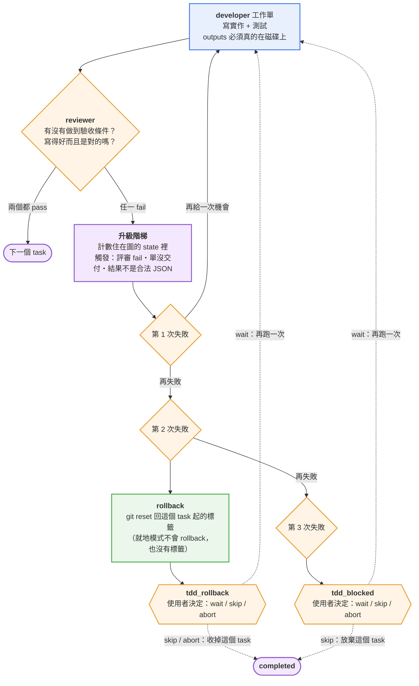
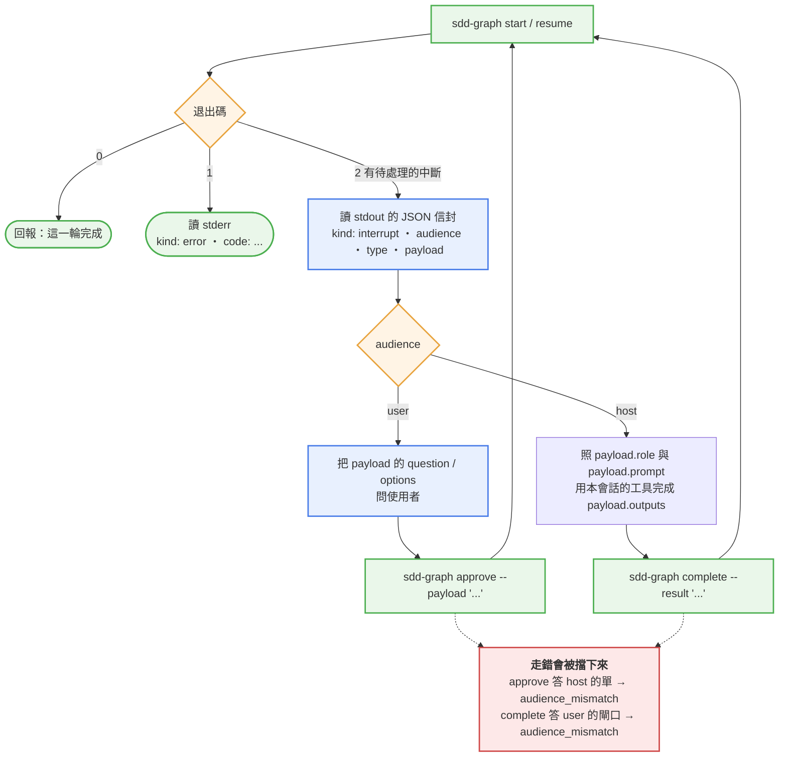

# sdd-graph

**圖（LangGraph）擁有階段路由，Claude Code 會話負責把工作單做完。**

一個 Claude Code 插件：一條 SDD（Spec-Driven Development）流程，七個階段，
每一段都有一張「工作單」。工作單不是拿來讀的，是拿來**做**的 ——
模型不再自己決定下一個階段是什麼，**圖決定**；模型只負責把手上那張單做完，然後回報。

- [這是什麼](#這是什麼)
- [快速開始：在一個新專案裡用起來](#快速開始在一個新專案裡用起來)
- [兩種工作模式](#兩種工作模式)
- [從舊版本遷移](#從舊版本遷移)
- [目標專案要準備什麼](#目標專案要準備什麼)
- [七個階段](#七個階段)
- [`/sdd-graph:*` 指令](#sdd-graph-指令)
- [`collect_prd`：一次問完三件事](#collect_prd一次問完三件事)
- [CLI 合約](#cli-合約)
- [Interrupt 類型](#interrupt-類型)
- [檔案落在哪裡](#檔案落在哪裡)
- [換會話、暫停、恢復](#換會話暫停恢復)
- [為什麼是這樣設計](#為什麼是這樣設計)
- [開發](#開發)
- [v1 不做的清單](#v1-不做的清單)
- [參考文件](#參考文件)

---

## 這是什麼

一般的「AI 寫程式」流程裡，模型自己決定接下來做什麼：先問需求？還是先看程式碼？
寫完要不要測試？測試失敗要改哪裡？每一步都靠模型判斷，**同一個需求跑兩次會走不同的路**，
而且中途被切斷之後沒有人知道跑到哪了。

`sdd-graph` 把「決定流程」跟「做事情」拆開：

```
使用者 ──對話──► Claude Code 會話（/sdd-graph:* 指令）
                    │
                    │  循環：跑圖 → 看 payload → 問人 or 幹活 → complete / approve
                    ▼
              sdd-graph CLI（bin/sdd-graph）
                    │
                    ▼
             LangGraph + SqliteSaver
               確定性節點直接執行（bootstrap / verify / git / parse）
               需要人腦的節點 = interrupt（audience: user）
               需要動手的工作單 = interrupt（audience: host）
```

- **圖**（LangGraph）決定下一個階段是什麼、什麼時候要問人、什麼時候要發工作單。
  這條路由是**確定的**：同樣的狀態一定走同樣的路。
- **會話**（Claude Code）拿到一張工作單，用自己既有的工具（寫檔、跑測試、拉 Figma）
  把它做完，然後回報「做完了，产出在這裡」。
- 中斷之後**可以接著做**：進度存在 checkpoint（sqlite）裡，不是存在對話裡。

**兩種 audience 嚴格分開**：

| audience | 誰來處理 | 用哪個指令 | payload |
|---|---|---|---|
| `user` | 人（Claude Code 會話把問題問出來） | `sdd-graph approve` | 問題／選項 |
| `host` | 本會話的工具（寫檔、跑測試、拉 Figma） | `sdd-graph complete` | 工作單（role／prompt／inputs／outputs） |

`approve` 去答一張 `host` 的單、或 `complete` 去答一張 `user` 的閘口，都會被擋下來
（`audience_mismatch`）—— 兩條路徑不會互相走錯。

---

## 快速開始：在一個新專案裡用起來

外掛是**裝在機器上**的（user scope），不是裝在某個專案裡。裝好之後，
任何專案的 Claude Code 會話裡都會有 `/sdd-graph:*` 這幾個指令。

### 步驟 0 — 前提

| 需要 | 版本／說明 |
|---|---|
| Node.js | **≥ 20.11**（測試用到 `import.meta.dirname`） |
| git | 能 clone、能建分支 |
| Claude Code | 支援插件的版本（本外掛在 2.1.295 上驗過） |
| Figma MCP | **選配** —— 只有在你要給 Figma 網址時才需要 |

### 步驟 1 — 取得並安裝外掛

```bash
git clone https://github.com/sukunwei/frontend-sdd-agent.git
cd frontend-sdd-agent
npm install
```

`npm install` 會裝上執行時需要的 `@langchain/langgraph`、
`@langchain/langgraph-checkpoint-sqlite`、`zod`，還有 `tsx`（`bin/sdd-graph` 是一支
tsx shim）。

### 步驟 2 — 裝成 Claude Code 插件

**這個倉庫自己就是一個 marketplace**：`.claude-plugin/marketplace.json` 宣告了唯一的
plugin `sdd-graph`，來源就是倉庫根目錄（`"./"`）。

```bash
claude plugin marketplace add /絕對路徑/frontend-sdd-agent
claude plugin install sdd-graph@sdd-graph
```

> **為什麼不用 symlink。** 常見的作法是「在一個 local marketplace 裡放一個指向本目錄的
> symlink」。**現在的 Claude Code 會拒絕這種來源**：
>
> ```
> Plugin source path refused: ./plugins/sdd-graph does not stay inside its
> marketplace directory. Check that the marketplace entry has a plain relative path.
> ```
>
> 外掛的來源必須是 marketplace 目錄裡的一個**普通相對路徑**。把倉庫自己當成
> marketplace（來源是 `"./"`）就沒有這個問題，而且少一份要同步的副本。

> **改了外掛之後不用重裝。** 目錄來源的 marketplace 是**直接從那個資料夾讀**的
> （`claude plugin list` 會寫 `Read from: <目錄>`）。改了外掛之後**重開會話**
> （或 `/reload-plugins`）就會生效 —— 改 `commands/*.md`、`prompts/*.md` 也一樣，
> 會話載入的就是源碼目錄裡的那幾個檔案。
>
> **萬一重開會話後 `/sdd-graph:start` 不見了**：用 `/plugin` → marketplace `sdd-graph`
> → reinstall 兜底。

### 步驟 3 — 確認裝好了

```bash
claude plugin list | grep -A 4 sdd-graph
```

應該看到：

```
  ❯ sdd-graph@sdd-graph
    Version: 0.2.0
    Read from: /絕對路徑/frontend-sdd-agent
    Scope: user
    Status: ✔ enabled
```

再確認 CLI 跑得起來：

```bash
/絕對路徑/frontend-sdd-agent/bin/sdd-graph status --task demo
```

它會回 `no_checkpoint` 並退出 1 —— 那是對的（沒有那一輪的進度），它證明 CLI 跑得起來。

### 步驟 4 — 在你的專案裡開始第一輪

開一個新的 Claude Code 會話，**cd 到你的專案**，然後：

```
/sdd-graph:start --task my-feature
```

`--task` 是這一輪的名字（會被正規化成 kebab-case，同時是 thread id、branch 名稱
`task/<name>` 與需求文件目錄 `docs/<name>/` 的來源）。

**`--repo` 是選用的**，它決定「在哪裡幹活」：

| `--repo` | 模式 | 程式碼與 `docs/<name>/` 落在 | 運行時狀態落在 |
|---|---|---|---|
| 省略（**預設**） | **就地工作** | 你現在所在的這個倉庫 | `<倉庫>/.sdd/` |
| `<url>`（含 `file://`） | 克隆模式（舊的用法） | `<外掛目錄>/workspace/tasks/my-feature/repo` 這份副本 | `<外掛根>/runtime/` |

兩種模式的完整差別見 [兩種工作模式](#兩種工作模式)。

接下來會發生什麼：

1. 圖準備好工作分支（就地模式：在**你的**倉庫裡切出 `task/my-feature`；克隆模式：在
   副本裡 clone + 切分支），並且**拿住分支鎖**（就地模式的鎖是那個倉庫自己的）。
2. 圖停在 `collect_prd`，**一次問你三件事**：PRD（路徑或文字）、設計（Figma 連結或
   文字描述）、其他文件（選填）。需求是使用者給的，不是模型編的。細節見
   [`collect_prd`：一次問完三件事](#collect_prd一次問完三件事)。
3. 你回答 → 圖進 `spec` → 發一張 `spec_writer` 工作單給會話 → 會話寫出
   `discovery.md` + `spec.md`（含驗收條件 `AC-001`…）→ 圖解析、追問、確認。
4. `e2ePlan` → `taskSplit` → `tdd`（每個 task 一輪：實作 → 審查）
   → `verification`（四道關卡）→ `completed`。
5. 每一段要你確認的閘口（`confirm_prd` / `confirm_spec` / `confirm_e2e` / `confirm_tasks`）
   都會問你。

### 步驟 5 — 一輪下來會留下什麼

**就地模式（預設）**：

- **在你的 repo 裡**：`task/my-feature` 分支上有 `docs/my-feature/` 底下的
  `prd.md`、`design.md`（有文字描述的設計時）、`refs/*`（有其他文件時）、
  `discovery.md`、`spec.md`、`e2e-plan.csv`、`tasks.md`、
  `workflow-state.json`、`verify/*.log`，以及實作出來的程式碼與測試。
  **外掛不會替你 commit 或 push** —— 產物留在那條分支上，等你看過再自己提交、合併。
  （**程式碼由工人 commit 在那條分支上**；`docs/<name>/` 與「要不要合併回你的主分支」
  由你處理。）
- **在你的 repo 裡**：`.sdd/`（`checkpoints.sqlite` 這一輪的進度、`branch-lock.json`
  這個倉庫的分支鎖）。這是**運行時狀態，建議加進 `.gitignore`**（插件只提示，不代勞）。

**克隆模式（`--repo <url>`）**：

- **在外掛目錄的副本裡**：同樣的 `docs/my-feature/` 與程式碼，但它們在
  `<外掛目錄>/workspace/tasks/my-feature/repo` 這份**副本**裡。那條分支會被推上去；
  推不上去也不影響流程，只是分支留在本地。
- **在外掛目錄裡**：`workspace/tasks/my-feature/`（clone 與 metadata）、
  `runtime/checkpoints.sqlite`（這一輪的進度）、`runtime/branch-runtime-lock.json`
  （全域的分支鎖）。

---

## 兩種工作模式

`sdd-graph` 有兩種「在哪裡幹活」的模式。**預設是就地工作**。

|  | **就地工作（預設）** | **克隆模式** |
|---|---|---|
| 怎麼啟動 | 在業務倉庫目錄裡執行 `/sdd-graph:start --task <name>`（**省略 `--repo`**） | `/sdd-graph:start --task <name> --repo <url>`（含 `file://`） |
| 程式碼寫在哪 | **你現在所在的倉庫**，`task/<name>` 分支上 | `<外掛根>/workspace/tasks/<name>/repo` 這份副本 |
| 需求文件寫在哪 | `<業務倉庫>/docs/<name>/`（**進版本庫**） | `<副本>/docs/<name>/` |
| checkpoint | `<業務倉庫>/.sdd/checkpoints.sqlite` | `<外掛根>/runtime/checkpoints.sqlite` |
| 分支鎖 | `<業務倉庫>/.sdd/branch-lock.json`（**按倉庫**） | `<外掛根>/runtime/branch-runtime-lock.json`（**全域**） |
| 工作區有未提交的改動時 | 停下來問你（見下） | 副本是新的，乾淨 |

**就地模式為什麼是預設**：外掛本來就應該在你自己的專案裡幹活。舊的「clone 一份到
外掛目錄」的做法會讓你 review 不到真正的產物、也讓你多一份要同步的副本 —— 而
`docs/<name>/` 與程式碼分家，「需求文件跟著程式碼一起進版本庫」這件事就不成立。

### 就地模式不做的事

就地模式在**你的**倉庫裡動手，所以有一堆事情它**故意不做**。知道這些，
你才知道什麼要自己來：

- **不自動 commit / push**：外掛的圖與 CLI 自己**不執行 `git commit`、不執行
  `git push`** —— 什麼該進版本庫、要不要推上遠端，由你決定。跑完你停在
  `task/<name>` 分支上，產物（程式碼、`docs/<name>/`）留在那裡等你 review 之後
  自己提交、合併。（工作單的工人會照 `prompts/developer.md` 的規則把自己的改動
  commit 在那條分支上；**推上遠端與合併回你的主分支永遠是你的動作**。）
- **不自動回滾**：task 連續失敗兩次時，圖**不會**把你的程式碼還原 —— **壞代碼原樣
  留在你的倉庫裡**，等你手動收拾。（克隆模式會在**第二次**失敗時 `git reset --hard`
  回到 task 的起點；就地模式連這件事都沒有，第三次失敗是 `tdd_blocked` 閘門，
  也不回滾。）就地模式的閘門訊息會直接寫明「就地模式不做任何自動回滾」。
- **不打 `sdd/task/*` tag**：沒有回滾點就不需要 tag，你的倉庫裡不會多出外掛的 ref。
- **不改你的 `.gitignore`**：`.sdd/` 沒被忽略時，輸出裡給一行提示，要你把
  `/.sdd/` 加進 `.gitignore`；**不代勞**寫你的檔案。
- **不 stash 你的改動**：工作區有**已跟蹤文件**被改過時會停下來問你
  （`dirty_worktree` 閘門）：`proceed` = **留在當前分支上繼續**（外掛不切分支、
  你的改動原封不動），`abort` = 中止這一輪。**未跟蹤的檔案不算髒**，不攔你。
- **不刪你的東西**：`reset` 只清 `.sdd/` 底下這個 task 的運行時狀態；
  `docs/<name>/`、分支、程式碼都不動 —— 那些產物要你自己收拾。

### 行為變更（從舊版升上來）

1. **`--repo <本地路徑>` 的語義變了**：以前是「把這個路徑 clone 一份到外掛目錄」，
   現在會被判成「**就地工作**」的路徑 —— **但只有在它就是 cwd 所在的倉庫時才成立**
   （`--repo .` 可以）；指向別的倉庫會被拒絕（見下一條）。要保留舊行為請改用
   `file://` 前綴（`--repo file:///絕對/路徑`）。
2. **`--repo` 指向 cwd 之外的本地倉庫會被拒絕**（就地模式要求在業務倉庫目錄裡執行）：
   錯誤訊息是「就地模式要求在業務倉庫目錄裡執行」。那條路徑會造成「啟動了卻再也
   找不到」的 run —— 在 repo A 啟動、在 repo B 裡 resume，這輪 run 會被綁到 B 的
   同名 task 上，而 A 裡再也沒有它。
3. **`stop --force` 不再能釋放別的 task 持有的鎖**：別的活著的 task 握著鎖時，
   `stop` 會報錯（`lock_not_owned`），請先把那個 task 停掉
   （`sdd-graph stop --task <那個 task>`）。以前 `--force` 能把別的 task 的鎖刪掉，
   那等於替別人中止了他正在跑的那一輪；而鎖現在是**按倉庫**的，搶錯倉庫的鎖更危險。

---

## 從舊版本遷移

舊版本把 checkpoint 放在外掛根底下一份**全域**的庫（`runtime/checkpoints.sqlite`），
兩個倉庫裡同名 task 的 run 會互相蓋掉。就地模式把狀態搬進每個倉庫自己的 `.sdd/`，
所以舊的進度要搬過去：

```bash
sdd-graph migrate --repo <你的業務倉庫路徑>
```

（`--repo` 省略時用目前的工作目錄；給 URL 會被拒絕 —— 狀態要搬進**本機**倉庫的
`.sdd/` 之下。）

`migrate` 做的事：

- **逐個 thread 判歸屬**：舊 thread 的 `repoUrl` 跟這個倉庫的 `remote.origin.url`
  一致才搬。不一致的**不搬**，會列在輸出的 `skipped` 裡並附上原因。
- **舊庫先備份成 `<舊庫>.bak`，舊庫本身不刪** —— 確認搬好了再自己清理。
- **一個 thread 混了兩個倉庫的 checkpoint → 不搬**（搬整條等於把別個倉庫的進度一起
  搬過來），列在輸出的 `mixed` 裡，請手動處理。
- **這個倉庫沒有 `remote.origin.url` → 一條都不搬**（沒有判準就沒有歸屬），
  舊庫裡還在的 thread 全部列在 `skipped` 裡。
- **舊的分支鎖不遷**：那把鎖是全域單例，可能握在別的倉庫的 task 手上 —— 遷移只提示
  （「舊的分支鎖仍指向 X，請先 stop 那個 task」），不碰它。

輸出是 JSON 信封：`migrated`（搬過去的 thread）、`skipped` 與 `skippedReasons`
（沒搬的與原因）、`mixed`、`target`（新庫的位置）、`backup`（備份路徑）。

---

## 目標專案要準備什麼

`sdd-graph` 會**真的**跑你的工具鏈；克隆模式還會**真的** clone 你的專案。所以目標 repo 要符合：

| 需要 | 說明 |
|---|---|
| **是個 git repo** | 就地模式：你的專案本身就得是 git repo（外掛就在它裡工作）。克隆模式：能被 clone（https／ssh／`file://`／本機路徑都可以）。不需要先有 `main` 分支以外的東西。 |
| **四道關卡的工具** | 驗證階段會在**目標 repo**（就地模式 = 你的倉庫；克隆模式 = 副本）裡跑這四個指令（**版本寫死在 `src/nodes/verify-checks.ts`**）：<br>`npx tsc --noEmit` ／ `npx eslint . --ext .ts,.tsx --fix` ／ `npx jest --passWithNoTests --no-coverage` ／ `npx playwright test` |
| **eslint 8** | `--ext` 這個選項在 eslint 9 已被移除。專案裡要有 `eslint`（v8）與一份設定檔。 |
| **可以 commit** | 工人（會話）會把工作 commit 在 `task/<name>` 分支上。**就地模式：外掛自己不 commit、不 push**（推上遠端與合併是你的動作）；**克隆模式：外掛會在建分支時 push 一次**（推不上去不影響流程，分支留在本地），之後的 commit 一樣由工人做。 |
| **（選配）Figma MCP** | 你在 PRD 階段給了 Figma 網址時，會話會用 Figma MCP 抓設計資源。 |

> **想改關卡的指令？** v1 把它寫死了 —— 這是刻意的：那四道關卡就是這個外掛的
> 「品質底線」，不該由每個專案各自定義。要改的話改 `VERIFY_CHECKS` 那一段，
> 順便把 `tests/verify-*.test.ts` 一起改。

---

## 七個階段

```
bootstrap → prd → spec → e2ePlan → taskSplit → tdd → verification → completed
```

| 階段 | 誰執行 | 產出 | 閘口 |
|---|---|---|---|
| `bootstrap` | 確定性（圖內） | 工作分支、分支鎖、run-metadata（**clone 只在克隆模式**；就地模式直接用你的倉庫） | 鎖衝突／舊 run 要 resume 還是 reset（就地模式另加：工作區髒了要你決定） |
| `prd` | **先問人** | `prd.md`、`design.md`、`refs/*`、`figma/*`（含 HTML 原型） | `collect_prd` →（有 Figma URL 才）`figma_fetch` → `figma_prototype` → 量測 →（必要時）`figma_polish` → `confirm_prd` |
| `spec` | 工作單 | `discovery.md` + `spec.md` | 澄清最多 3 輪、blocking TBC 未解不得離開、`confirm_spec` |
| `e2ePlan` | 工作單 | `e2e-plan.csv` | `confirm_e2e` |
| `taskSplit` | 工作單 | `tasks.md` | `L` 要看起來像一個行為（≥3 條驗收條件）、id 不得重複、id 要由標題派生、`confirm_tasks` |
| `tdd` | 工作單 × N（開發者 → 審查） | 程式碼、測試、評審 JSON | 失敗兩次 rollback（**就地模式不回滾**）、第三次問使用者 |
| `verification` | 確定性（圖內） | 四道關卡的結果 | `lint:ts` → `lint` →（`test` ∥ `e2e`），失敗要使用者決定 |

### 流程圖

> 下面的圖是 [mermaid](https://mermaid.js.org/) —— GitHub 會直接渲染。用純文字看
> README 的話，表格與程式碼區塊說的是同一件事。

```mermaid
flowchart TD
  START(["start"]) --> BOOT

  BOOT["<b>bootstrap</b> · 確定性<br/>工作區・分支鎖・clone 專案<br/>（clone 只在克隆模式；就地模式直接用你的倉庫，鎖按倉庫）"]
  BOOT --> PRD

  PRD["<b>prd</b> · 先問人<br/>需求由使用者給，不是模型編的"]
  PRD --> PRD_Q{{"<b>collect_prd</b><br/>把 PRD 問使用者"}}
  PRD_Q --> PRD_F["<b>figma_fetch</b> 工作單<br/>抓 P0 資源 + 每個 frame 一張截圖"]
  PRD_F --> PRD_P["<b>figma_prototype</b> 工作單<br/>用 figma-implement-design skill 做 HTML 原型"]
  PRD_P --> PRD_D["<b>UI diff</b> · 確定性<br/>渲染原型 vs Figma 截圖"]
  PRD_D --> PRD_R{"有硬失敗？"}
  PRD_R -->|"有"| PRD_X["<b>figma_polish</b> 工作單<br/>修到量得進去"]
  PRD_X --> PRD_D
  PRD_R -.->|"沒有"| PRD_C{{"<b>confirm_prd</b><br/>使用者確認 PRD"}}
  PRD_C -.->|"不確認"| PRD_Q
  PRD_C --> SPEC

  SPEC["<b>spec</b> · 工作單<br/>spec_writer → discovery.md + spec.md"]
  SPEC --> SPEC_Q{{"<b>spec_questions</b> / <b>tbc_blocking</b><br/>澄清・待確認項"}}
  SPEC_Q -.->|"還有未解的"| SPEC
  SPEC_Q --> SPEC_C{{"<b>confirm_spec</b><br/>使用者確認規格"}}
  SPEC_C -.->|"退回"| SPEC
  SPEC_C --> E2E

  E2E["<b>e2ePlan</b> · 工作單<br/>e2e_planner → e2e-plan.csv"]
  E2E --> E2E_C{{"<b>confirm_e2e</b>"}}
  E2E_C -.->|"退回"| E2E
  E2E_C --> TS

  TS["<b>taskSplit</b> · 工作單<br/>task_splitter → tasks.md<br/>L 要像一個行為・id 不得重複"]
  TS --> TS_C{{"<b>confirm_tasks</b>"}}
  TS_C -.->|"退回"| TS
  TS_C --> TDD

  TDD["<b>tdd</b> · 工作單 × N<br/>developer → reviewer（spec ＋ quality）"]
  TDD --> VER

  VER["<b>verification</b> · 確定性<br/>lint:ts → lint →（test ∥ e2e）"]
  VER --> VER_Q{{"<b>verify_failed</b><br/>使用者決定怎麼辦"}}
  VER_Q -.->|"manual：回去修"| TDD
  VER_Q -.->|"skip / abort"| DONE
  VER --> DONE(["<b>completed</b>"])

  classDef gate fill:#fff4e5,stroke:#e8a33d,stroke-width:2px
  classDef work fill:#e8f0fe,stroke:#4a7de8,stroke-width:2px
  classDef det fill:#eaf7ea,stroke:#4caf50,stroke-width:2px
  classDef term fill:#f3e8fd,stroke:#8e5bd0,stroke-width:2px

  class PRD,PRD_Q,PRD_C,PRD_R,SPEC_Q,SPEC_C,E2E_C,TS_C,VER_Q gate
  class PRD_F,PRD_P,PRD_X,SPEC,E2E,TS,TDD work
  class BOOT,PRD_D,VER det
  class START,DONE term
```



| 顏色 | 意思 |
|---|---|
| 橘 | 使用者閘口 —— 要人決定 |
| 藍 | 工作單 —— 會話用本會話的工具做 |
| 綠 | 圖內確定性 —— 圖自己算完 |
| 紫 | 起訖 |

`prd` 階段是**先問人**的：需求是使用者給的，不是模型編的。
每一段的需求文件都寫在 repo 裡（`docs/<requirement>/`），跟程式碼一起被 commit。

**給了 Figma 連結時，PRD 階段會多做兩件事**：把抓到的資源做成一頁靜態 HTML 原型，
再拿原型渲染出來的畫面跟 Figma 截圖做像素比對。原型做得出來，代表抓到的資源夠用；
做不出來，代表抓漏了 —— 這時候**還沒寫任何產品程式碼**，修的成本只有改一份 HTML。
比對的證據留在 `docs/<requirement>/figma/diff/report.md`。

**TDD 迴圈**是兩張單一輪：會話拿到 `developer` 工作單（要寫實作**和**測試）→
`reviewer`（一次回答兩個問題：有沒有做到驗收條件？寫得好而且是對的嗎？）。
評審不通過就回到 developer。連續失敗會 `rollback`（回到這個 task 起的 git 標籤），
第三次才會問使用者。**就地模式不會 rollback、也沒有標籤** —— 壞代碼原樣留在你的
倉庫裡，由你手動收拾。

> **以前是三張單**：規格審查與品質審查各一張。兩張單讀的是同一批檔案、同一份 diff，
> 第二次來回買到的東西很少 —— 每個 task 因此少付一次來回。

### TDD 的一輪



---

## `/sdd-graph:*` 指令

| 指令 | 作用 |
|---|---|
| `/sdd-graph:start --task <name> [--repo <url>]` | 開始一輪：跑圖、依退出碼分支，一路問人或幹活到結束。**省略 `--repo` ＝ 就地工作**（要在業務倉庫目錄裡執行）；給了 URL ＝ 克隆模式 |
| `/sdd-graph:resume --task <name>` | 從 checkpoint **重發同一張**未完成的工作單（換會話也能接著做）。**要 cd 到那一輪所在的目錄** |
| `/sdd-graph:status --task <name>` | **只讀**：目前階段、待處理的中斷、分支鎖。不推進任何階段 |
| `/sdd-graph:stop --task <name>` | 釋放分支鎖；**保留** checkpoint 與工作區。`--force` **不再能搶別的 task 的鎖** |
| `/sdd-graph:change --task <name>` | v1 只預留：回 `not_implemented`，不會默默忽略 |
| `sdd-graph migrate --repo <path>` | 把舊版本遺留在外掛根的全域 checkpoint 搬進 `<業務倉庫>/.sdd/` 之下（**CLI 命令**，沒有對應的斜線指令；見 [從舊版本遷移](#從舊版本遷移)） |

指令本體只有一個控制流（`commands/start.md` 與 `commands/resume.md` 裡同一份 LOOP；
`--repo` 是選用的，沒有它就是就地模式）：

```
LOOP:
  1. 執行 sdd-graph start --task <taskName> [--repo <repoUrl>]
  2. 依退出碼分支：
     - exit 0：階段已完成，向使用者回報，結束
     - exit 2：讀 stdout 的 JSON 信封，依 audience 分支
         · audience=user：把 payload 的 question/options 問使用者；
           使用者答完後執行 sdd-graph approve --task <taskName> --payload '<json>'
         · audience=host：依 payload.role 與 payload.prompt，用本會話工具完成 payload.outputs；
           完成後執行 sdd-graph complete --task <taskName> --result '<json>'
     - exit 1：讀 stderr，向使用者回報錯誤，結束
  3. 回到步驟 1
```

---

## `collect_prd`：一次問完三件事

`/sdd-graph:start` 之後，圖停的第一個閘門就是 `collect_prd`。它一次問三件事：

1. **PRD** —— 文件路徑，或文字描述
2. **Figma** —— 設計檔連結，或用文字描述設計；沒有設計就說沒有
3. **其他文件** —— 選填，規格階段要一起讀的

閘門的 payload 帶著 `question`（那三個問題）與 `answer`（答案的形狀）：

```jsonc
{
  "prd":   "<markdown>" | { "path": "/absolute/path/to/PRD.md" },
  "figma": "<figma url>" | { "url": "https://..." } | { "text": "<the design, in words>" } | null,
  "docs":  [ { "path": "/absolute/path/to/other.md" } | { "name": "other.md", "text": "..." } ]
}
```

**路徑由圖自己去讀**，內容原封不動寫進 `docs/<task>/`：

| 你給的 | 落在 |
|---|---|
| PRD（路徑或文字） | `docs/<task>/prd.md` |
| Figma **連結** | `docs/<task>/figma/*`（宿主用 Figma MCP 抓的 P0 資源） |
| Figma **文字描述** | `docs/<task>/design.md` |
| 其他文件 | `docs/<task>/refs/<檔名>` |

- **讀不到路徑不會弄死那一輪。** 閘門帶著診斷（`note`）再問一次，告訴你是哪個路徑出問題。
- **答應的形狀不對會出錯**（`throw`），不會無聲地再問一次 —— 那是宿主的 bug，要吵。
- 舊的形狀 `{ "prdMarkdown": "...", "figmaUrl": "..." }` 照樣認得。

**設計只問一次。** 閘門記下你的決定（`url` / `text` / `none`），spec 階段**不會**再問第二次
—— 只有「你給了 Figma 連結、但 P0 抓不到」時才會再問（那時要決定：重抓、記成 TBC、還是略過）。

**`confirm_prd` 會告訴你圖到底收了什麼**（來源路徑、位元組數、其他檔案），你看得見再批准。

---

## CLI 合約

```bash
sdd-graph start    --task <n> [--repo <path|url>]
sdd-graph resume   --task <n>
sdd-graph complete --task <n> --result <json|@file>
sdd-graph approve  --task <n> --payload <json|@file>
sdd-graph status   --task <n>
sdd-graph stop     --task <n> [--force]
sdd-graph migrate  [--repo <path>]
sdd-graph change   --task <n>
sdd-graph figma-diff --docs <dir> [--repo <dir>]
```

**退出碼就是合約**，stdout 的 JSON 只說「發生了什麼」：

| exit | 意思 | stdout | stderr |
|---|---|---|---|
| `0` | 圖走到 `completed`（或這次命令沒有待處理的東西） | `{"kind":"result",...}` | - |
| `2` | 有待處理的中斷 | `{"kind":"interrupt","audience":...,"type":...,"threadId":...,"stage":...,"payload":...}` | - |
| `1` | 參數錯、沒有這個 thread、違反 audience 合約 | - | `{"kind":"error","code":...,"message":...}` |

宿主（Claude Code 會話）拿到退出碼之後做的事：


stderr 上會出現的錯誤碼：`invalid_arguments`、`no_checkpoint`、`audience_mismatch`、
`invalid_result`、`invalid_payload`、`invalid_order`、`already_completed`、
`lock_not_owned`、`not_implemented`、`validation_error`、`aborted`、
`internal_error`。（`dirty_worktree` 不在這裡 —— 它是**閘門 payload** 的 `code`，
走 stdout 的中斷信封。）

### `sdd-graph figma-diff`：量原型跟 Figma 截圖的差異

這個命令**不碰圖**，它量的是 HTML 原型跟 Figma 截圖差多少。工人（會話）跟圖
呼叫的是**同一支程式**：工人在自己的回合裡改到滿意，圖最後再跑一次當權威證據。

```bash
sdd-graph figma-diff --docs <需求目錄> --repo <目標專案>
```

| exit | 意思 |
|---|---|
| `0` | 量完了，沒有硬失敗（**像素有一點差是正常的**，那是軟指標） |
| `1` | 量完了，但有硬失敗：某個 frame 缺頁子、頁子渲染不出來、或截圖與渲染的尺寸對不上 |
| `2` | 命令跑不起來（例如 `--docs` 不存在） |

報告寫在 `<需求目錄>/figma/diff/`：`report.md`（人看）、`frames.json`（機器看）、
每個 frame 的差異圖，以及 HTML 實際渲染出來的 `render/<frameKey>.png`。

**瀏覽器是目標專案的**：這支命令跑 `npx playwright screenshot`，用的是目標專案
自己的 Playwright（驗證階段的 e2e 關卡本來就靠它）。目標專案沒有 Playwright 的話，
硬失敗的訊息會說得出來。

**工作單的輸出必須真的在磁碟上**：`complete` 會檢查工作單 `outputs` 裡的每個路徑。
沒寫出來 → **同一張單再發一次**，而且不計任何失敗次數（那不是品質問題，
是工人根本沒做完）。

**閘口答案的形狀很寬**：`approve` 可以收純字串，或任何帶著 `action`／`answer`／
`comment`／`text`／`option`／`value`／`response`／`decision`／`choice` 其中一個欄位的
物件。看不懂的形狀**不會**被當成「還沒回答」—— 圖會帶著 `previousAnswer` 再問一次，
而不是把你的答案吞掉。

---

## Interrupt 類型

圖會停下來的每一種理由都在這張表裡。表以外的 type 沒有被圖發出過。

| type | audience | 什麼時候 | 回來時帶什麼 |
|---|---|---|---|
| `already_exists` | user | `start` 撞到舊 run | `{ action: 'resume' \| 'reset' }` |
| `lock_conflict` | user | bootstrap | `{ action: 'wait' \| 'stop_other' }` |
| `dirty_worktree` | user | **就地模式**的 bootstrap：工作區有已跟蹤文件的改動 | `{ action: 'proceed' \| 'abort' }` —— `proceed` = 留在當前分支上繼續 |
| `bootstrap_failed` | user | 複製連續失敗 | `{ code, message }` |
| `collect_prd` | user | prd 入口 | `{ prd, figma, docs }` —— 見下 |
| `figma_missing` | user | 給了 Figma 連結但抓不到檔案 | `{ action: 'fetch' \| 'tbc' \| 'skip' }` |
| `figma_needs_human` | user | Figma 那一班的工人卡住了，要使用者決定 | `{ question, options }` |
| `work_order`（role=`figma_fetch`） | host | 使用者給了 Figma URL | `WorkerResult` |
| `work_order`（role=`figma_prototype`） | host | Figma 資源抓到了，做 HTML 原型 | `WorkerResult` |
| `work_order`（role=`figma_polish`） | host | 原型量不進去，修它 | `WorkerResult` |
| `work_order`（role=spec_writer 等） | host | 寫作／實作／評審 | `WorkerResult` |
| `worker_needs_human` | user | 工人卡住，要使用者決定（spec／e2e／task split） | `{ question, options }` |
| `confirm_prd` / `confirm_spec` / `confirm_e2e` / `confirm_tasks` | user | 階段出口 | `{ approved, comment? }` |
| `spec_questions` | user | spec 的澄清 | `{ answers }` |
| `tbc_blocking` | user | 推進前 | `{ resolutions }` |
| `spec_failed` | user | 規格讀不到，或沒有驗收條件 | `{ reason, message?, options: ['retry', 'abort'] }` |
| `e2e_plan_failed` | user | E2E 計畫沒有 test id | `{ reason, message? }` |
| `task_split_failed` | user | `tasks.md` 不合法（複雜度、id、AC 引用） | `{ reason, message? }` |
| `tdd_rollback` / `tdd_blocked` | user | TDD 升級：**第 2 次**失敗 = `tdd_rollback`（克隆模式在此 `git reset --hard` 回到 task 的起點），**第 3 次** = `tdd_blocked`（這輪就此放棄，**不回滾**） | `{ action: 'wait' \| 'skip' \| 'abort' }` |
| `verify_failed` | user | 四道關卡有 failed | `{ action: 'manual' \| 'skip' \| 'abort' }` |

**閘門的 payload 還會多帶這些欄位**（有的話）：

| 欄位 | 什麼時候 | 意思 |
|---|---|---|
| `rollback` | `tdd_rollback` | 程式碼到底有沒有被還原：`done`（還原了）、`skipped`（沒有 repository，沒得還原）、`failed`（有 repository 但 reset 失敗）。**後兩種情況壞掉的程式碼還在磁碟上。**<br>**就地模式一律是 `skipped`**（就地模式不做任何自動回滾），閘門訊息會直接寫明「就地模式不做任何自動回滾，壞代碼留在你的業務倉庫裡，請手動處理」。 |
| `previousAnswer` | 使用者的答案圖看不懂時 | 上一次那個看不懂的答案（原文）。圖會把閘門再問一次，帶著這個診斷。 |
| `note` | 同上 | 為什麼要再問一次。 |

工作單的 role：`figma_fetch`、`figma_prototype`、`figma_polish`、`spec_writer`、
`e2e_planner`、`task_splitter`、`developer`、`reviewer`。
工作單的正文在 `prompts/<role>.md`（模板），由 `src/prompts/loader.ts` 填入
目標、工作目錄、必讀輸入、必交輸出與產出格式。

### 實作者拿到的是「剛好夠」的東西

`developer` 與 `reviewer` 工作單的**必讀輸入很小**：

| 輸入 | 內容 |
|---|---|
| `spec.md` | 需求與邊界條件（整份） |
| `figma/prototype/<frameKey>.html` | **這個 task 實作的那一頁原型**（視覺真值） |
| `figma/screenshots/<frameKey>.png` | 同一個 frame 的 Figma 截圖 |
| `figma/prototype/css/tokens.css` | design token 已經是 CSS 變數了 |

`tasks.md` **不在輸入裡** —— 這個 task 的 id、描述、驗收條件、檔案清單本來就在工作單
的提示詞裡。整個 Figma 檔（`design-tree.json`、原始 token、全部 frame 的截圖）也不在：
**原型頁就是它們的提煉版**。

「這個 task 對應哪個 frame」是 `tasks.md` 裡 task 區塊的 `**Frames**:` 一行決定的
（沒有畫面的 task 省略這行）。

---

## 檔案落在哪裡

### 就地模式（預設）

```
<你的業務倉庫>/
├── docs/<task>/                  ← 需求文件（**要進版本庫**，跟程式碼一起提交 —— 插件不代你 commit）
│   ├── prd.md                    ← 使用者的需求（路徑或文字，原封不動）
│   ├── design.md                 ← 使用者用文字描述的設計（有的話）
│   ├── refs/*                    ← 使用者給的其他文件（有的話）
│   ├── discovery.md
│   ├── spec.md                   ← 含 AC-001…（規格的關卡）
│   ├── e2e-plan.csv
│   ├── tasks.md
│   ├── workflow-state.json       ← 給人看的狀態鏡像（圖獨家覆寫）
│   ├── verify/*.log              ← 四道關卡的日誌
│   └── figma/                    ← Figma 資源
│       ├── *.json / *.md         ← P0 資源（節點樹、token、設計說明）
│       ├── screenshots/          ← 每個 frame 一張 png
│       ├── prototype/            ← 靜態 HTML 原型（視覺真值來源）
│       │   ├── index.html
│       │   ├── <frameKey>.html
│       │   ├── css/tokens.css
│       │   └── assets/
│       └── diff/                 ← 原型跟截圖的 UI diff（report.md・frames.json）
├── <你的程式碼與測試>
└── .sdd/                         ← 運行時狀態（**建議加進 .gitignore**）
    ├── checkpoints.sqlite        ← 這一輪的進度（resume 的真源）
    ├── branch-lock.json          ← 這個倉庫的分支鎖（同一時間只有一輪能跑）
    ├── tasks/<task>/             ← 這個 task 的運行時目錄
    └── runs/<task>/
        └── run-metadata.json     ← runId、branch、repoUrl
```

### 克隆模式（`--repo <url>`）

```
<外掛目錄>/
├── workspace/tasks/<task>/
│   ├── repo/                     ← clone 出來的專案（會被 commit 的都在這裡）
│   │   ├── docs/<task>/          ← 需求文件（跟程式碼一起被 commit）
│   │   │   ├── prd.md             ← 使用者的需求（路徑或文字，原封不動）
│   │   │   ├── design.md          ← 使用者用文字描述的設計（有的話）
│   │   │   ├── refs/*             ← 使用者給的其他文件（有的話）
│   │   │   ├── discovery.md
│   │   │   ├── spec.md           ← 含 AC-001…（規格的關卡）
│   │   │   ├── e2e-plan.csv
│   │   │   ├── tasks.md
│   │   │   ├── workflow-state.json  ← 給人看的狀態鏡像（圖獨家覆寫）
│   │   │   ├── verify/*.log        ← 四道關卡的日誌
│   │   │   └── figma/              ← Figma 資源
│   │   │       ├── *.json / *.md   ← P0 資源（節點樹、token、設計說明）
│   │   │       ├── screenshots/    ← 每個 frame 一張 png
│   │   │       ├── prototype/      ← 靜態 HTML 原型（視覺真值來源）
│   │   │       │   ├── index.html
│   │   │       │   ├── <frameKey>.html
│   │   │       │   ├── css/tokens.css
│   │   │       │   └── assets/
│   │   │       └── diff/           ← 原型跟截圖的 UI diff（report.md・frames.json）
│   │   └── <你的程式碼與測試>
│   └── run-metadata.json          ← runId、branch、repoUrl
└── runtime/
    ├── checkpoints.sqlite         ← 這一輪的進度（resume 的真源）
    └── branch-runtime-lock.json   ← 全域分支鎖（同一時間只有一輪能跑）
```

> **就地模式的分支鎖是按倉庫的。** 同一個倉庫裡一次只有一輪能跑，不同倉庫互不影響。
> 跑完記得 `sdd-graph stop --task <name>` 釋放它（`stop` 只釋放鎖，checkpoint 與
> 工作區都留著）。
>
> **克隆模式的分支鎖是全域的。** 一次只有一輪能跑 —— 不管是哪個倉庫、哪條分支。
>
> **就地模式的狀態根可以搬到別處**：設 `SDD_GRAPH_SDD_HOME=/some/path` 就好
> （checkpoint 與鎖一起搬）。克隆模式的工作區也可以搬：
> `SDD_GRAPH_WORKSPACE_BASE=/some/path`（它的 checkpoint 與鎖**故意**不能搬 ——
> 它們是全域的）。

---

## 換會話、暫停、恢復

進度不在對話裡，在 checkpoint 裡。所以：

- **換一個會話接著做**：`/sdd-graph:resume --task <name>`。新會話沒有前一輪的記憶，
  它靠的是磁碟上的 sqlite 與工作單 `inputs` 裡的**絕對路徑**。
- **要 cd 到那一輪所在的目錄**：`resume` 沒有 `--repo`，圖靠 cwd 找狀態 —— 先查
  `<cwd 所在倉庫>/.sdd/checkpoints.sqlite`（就地模式），查不到才回落到
  `<外掛根>/runtime/checkpoints.sqlite`（克隆模式）。兩個都沒有這一輪時回
  `no_checkpoint`，訊息會把查過的位置列出來。
- **同一張單被重發**：`resume` 拿到的是**同一張**工作單（role／inputs／outputs 全等），
  不是一張新的。
- **bootstrap 不會重跑**：`resume` 走的是 checkpoint，不是 `start`，所以 repo 不會被重新複製。

中斷的時候，圖停在哪裡、為什麼停、下一張單是什麼，全都記在 checkpoint 裡。
`sdd-graph status --task <name>` 會把現況講出來（唯讀）。

---

## 為什麼是這樣設計

| 決定 | 理由 |
|---|---|
| **圖決定路由，模型只做工** | 流程變成確定的；同一個狀態一定走同樣的路。可以測試、可以重播。 |
| **checkpoint 與鎖按倉庫分開** | 舊版把狀態放在外掛根底下一份**全域**的庫：兩個倉庫裡同名 task 的 run 會互相蓋掉，A 倉庫跑任務也會鎖死 B 倉庫。搬到每個倉庫自己的 `.sdd/` 之後，一個倉庫的 run 只認自己那份。 |
| **就地模式不做任何自動回滾** | 克隆模式裡 `git reset --hard` 砸的是一次性的副本；在你的業務倉庫裡，同一個操作會直接毀掉你正在寫的東西。開始「代替你決定哪些改動該被撤銷」，就是在替你做價值判斷 —— 失敗就停在那兒，讓人收拾。 |
| **中斷分成 `user` 與 `host` 兩種 audience** | 「要人決定」跟「要動手做」是兩件不同的事。混在一起就會出現「用戶的答案被當成工作結果」。 |
| **每個節點最多呼叫一次 `interrupt()`** | LangGraph 的 `interrupt()` 是依 `scratchpad.resume[idx]` 取值的，第二次呼叫會**吃掉下一個排隊的答案**。要再問一次，就用 `goto` 路由回自己，讓它在**下一次執行**重新開始。 |
| **中斷必須是節點做的第一件事** | resume 時 LangGraph 會**重新執行整個節點**。排在 `interrupt()` 之前的副作用會跑兩次（停駐前一次、resume 後一次）。所以「先問、再寫」。 |
| **工作單的 inputs/outputs 一定是絕對路徑** | 換會話之後只能靠磁碟。相對路徑會被解析成「CLI 剛好在的那個目錄」。 |
| **檔案存在性由 CLI 檢查，計數由圖做** | CLI 是無狀態的 —— 它數不了「這張單被退回幾次」。那個計數器只能住在圖的 state 裡。 |
| **缺產物不計失敗次數** | 工人沒寫完檔案不是品質問題。算進去會讓無辜的工人被升級成 rollback。 |
| **v1 的工人就是 Claude Code 會話本身** | 不在圖裡嵌套 Agent SDK。會話已經有所有工具（檔案、shell、Figma MCP）。 |
| **四道關卡寫死** | 它們是這個外掛的品質底線，不該由每個專案各自定義。 |

---

## 開發

```bash
npm install
npx vitest run          # 全部測試
npm run typecheck       # tsc --noEmit
```

測試會真的 `git clone` 一個本機的臨時 repo（不連網），工作區與 checkpoint 都落在
臨時目錄裡（`SDD_GRAPH_WORKSPACE_BASE`），跑完外掛目錄不會留下垃圾。

端對端測試有兩半：程序內的那一半用 `runCli` 走完整條流程；行程級的那一半
**真的 spawn `bin/sdd-graph`**，斷言子行程的**退出碼**與 stdout 信封，並且在一個
**全新的行程**裡 `resume`，證明那張未完成的工作單是從 sqlite 檔案重新讀出來的
（宿主每個指令都是一個新的行程，換會話也一樣）。

### 原始碼地圖

```
src/
├── cli/          CLI 合約：退出碼、兩類 interrupt、兩種 audience
├── graph/        圖的骨架：state、reducers、compile（節點接線）
├── nodes/        各階段的節點（bootstrap / prd / spec / e2e-plan / task-split / tdd / review）
├── subgraphs/    tdd 子圖（三張單一輪 + 升級）、verify 子圖（四道關卡）
├── parsers/      文件解析：AC / TBC / Q / TASK slug / E2E csv
├── persistence/  checkpoint（sqlite）、ArtifactStore（狀態鏡像）
├── prompts/      工作單模板的載入與渲染
├── runtime/      路徑、task 名稱、分支鎖、git tag、clone、運行上下文、倉庫解析
└── state/        狀態的型別與 schema（1.1.0）
```

---

## v1 不做的清單

- retrospective／存檔／自動改 CLAUDE.md
- 第三位審查者（code-reviewer）與 Arbiter
- `trace-events.jsonl`、state 內的 telemetry
- pixelmatch／LHCI／a11y 關卡
- `/sdd-graph:change` 的真實實作（只預留入口）
- Postgres checkpointer、LangGraph Cloud
- 多 requirement 並行
- 巢狀 Claude Agent SDK／Cursor SDK 的無頭工人（v1 的工人就是 Claude Code 會話本身）
- 先做 MCP 再做圖

---

## 參考文件

| 文件 | 內容 |
|---|---|
| [`实现方案.md`](./实现方案.md) | 設計文件：架構、階段、CLI 合約、資料格式 |
| [`agent開發計畫.md`](./agent開發計畫.md) | 實作計畫：14 個 Task、每個 Task 的介面與驗收條件 |
